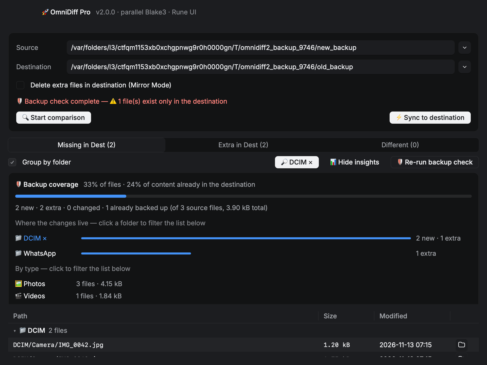
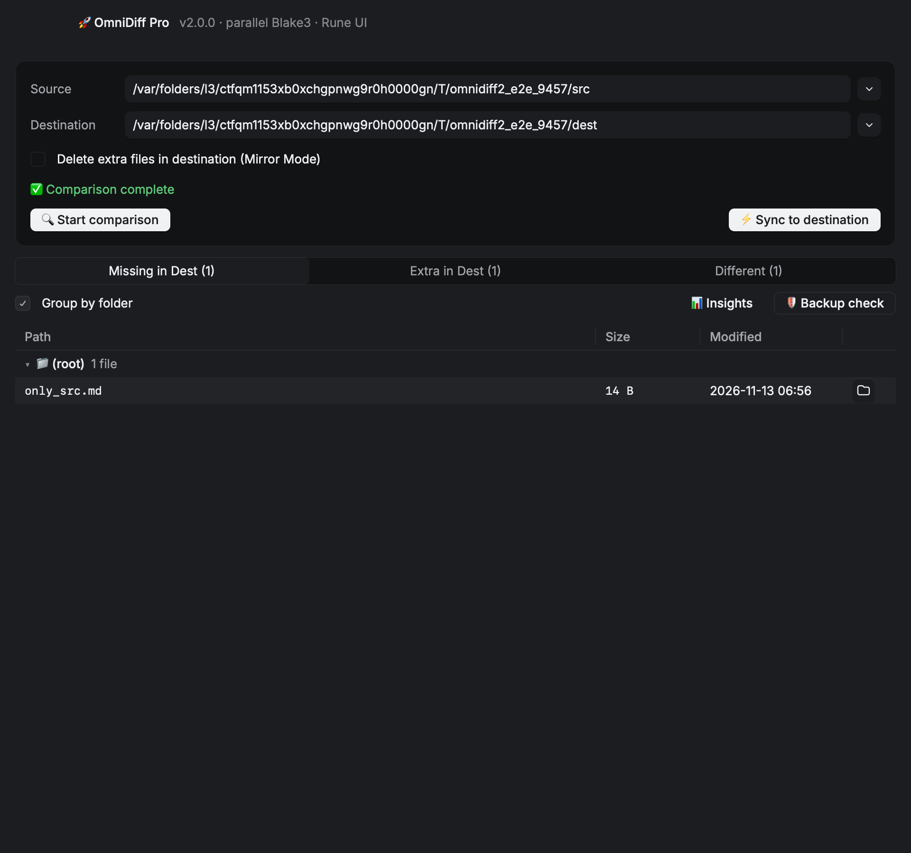
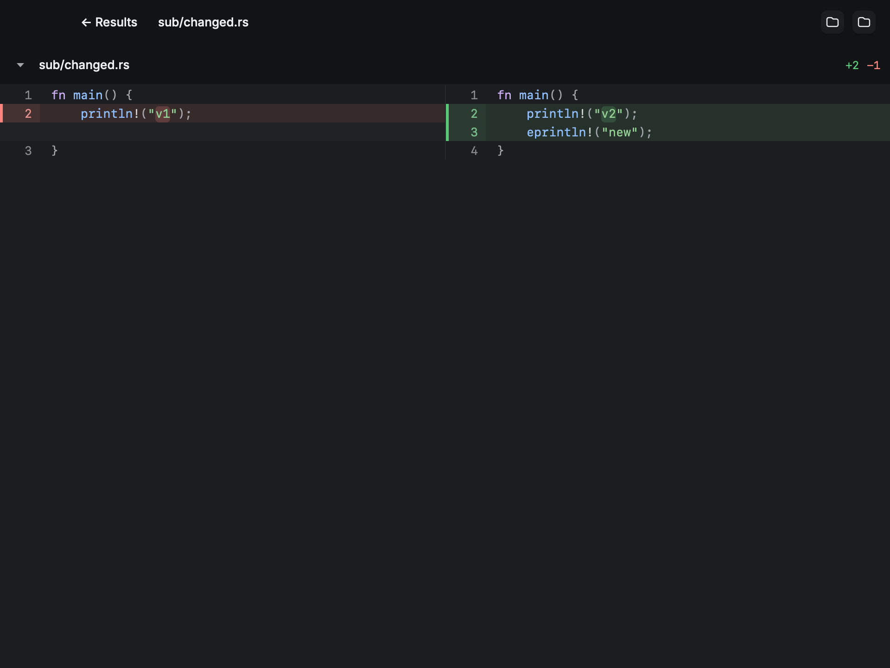
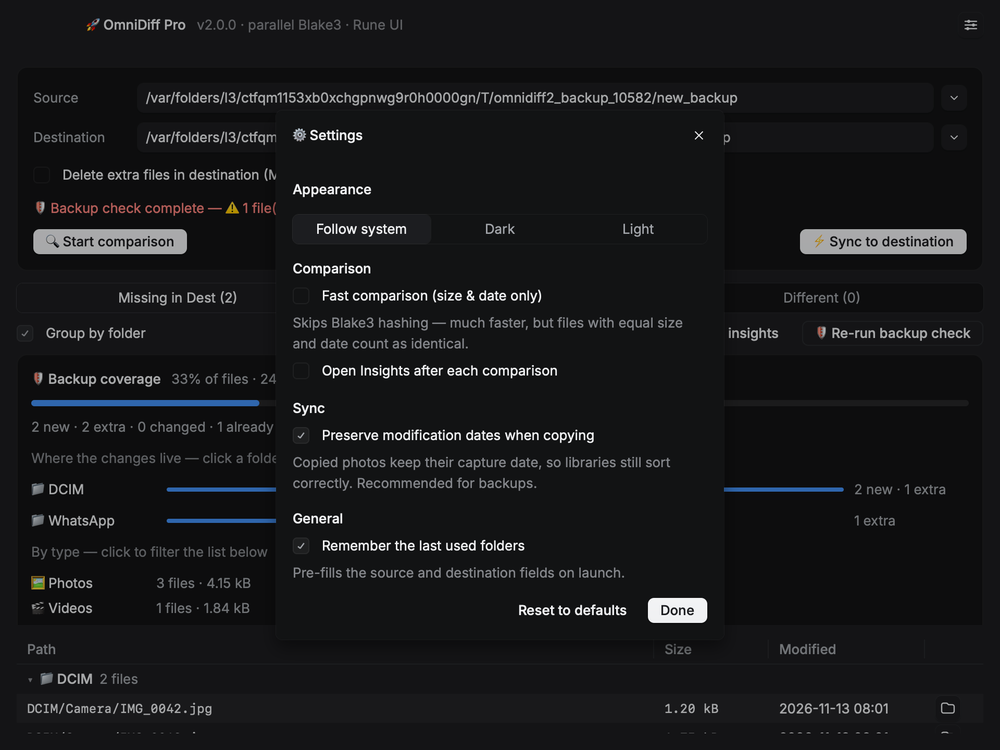
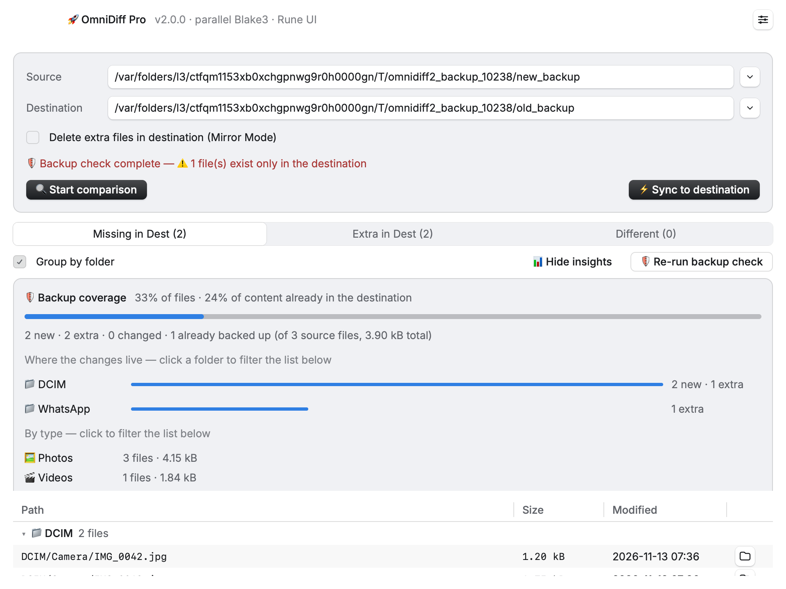

<div align="center">

# 🚀 OmniDiff

**Ultra-fast, industrial-grade folder comparison & synchronization for macOS — built in Rust.**

Compare backup folders, find renamed photos by *content*, verify nothing gets lost before a mirror sync, and review file changes in a GPU-rendered diff viewer.

[](LICENSE)
[](https://github.com/Blprk/OmniDiff/releases)
[](https://github.com/Blprk/OmniDiff/releases)
[](#-tech-stack)

</div>

---

OmniDiff ships in **two flavors** so you can pick your interface. Both use the same proven comparison engine (parallel folder scan + Blake3 content hashing) and can be installed side by side:

| | [**v2.0 — Rune UI**](https://github.com/Blprk/OmniDiff/releases/tag/v2.0.0) | [**v1.2 — Classic (egui)**](https://github.com/Blprk/OmniDiff/releases/tag/v1.2.0) |
|---|---|---|
| Rendering | GPU (one instanced draw call per frame) | egui |
| Diff viewer | Split/unified, word-level highlights, syntax coloring (80+ languages) | Basic side-by-side |
| Backup-safety check | ✅ Content-hash analysis | — |
| Insights panel | ✅ Clickable, rule-based | — |
| Show in Finder | ✅ Every row + both diff sides | — |
| Settings + dark/light/auto themes | ✅ | Follows system |
| Virtualized tables (100k+ files) | ✅ | ✅ |
| Native folder pickers | ✅ (non-blocking) | ✅ |
| Mirror-sync zero-loss guard | ✅ (names unique files that would be lost) | ✅ (count warning) |

> 🛡 **All correctness fixes are in both versions**: unreadable files are flagged instead of silently treated as identical, sync failures are reported, partial-hash reads are full-read correct, and nested/same folders are rejected.

---

## 🖼 Screenshots

<div align="center">

**Backup check & Insights panel** — content coverage, folder breakdown, renamed-photo detection, and the mirror-sync data-loss verdict.



**Results table** — grouped by folder, monospaced paths, Show-in-Finder on every row.



**Diff viewer** — split mode, syntax highlighting, word-level change highlighting.



**Settings** — dark / light / follow-system theme and engine preferences.



**Light mode**



</div>

---

## 🛡 Built for photo-backup workflows

OmniDiff was designed around a simple, terrifying question: *did my backup lose anything?*

1. **📊 Insights (instant)** — after a comparison, a rule-based panel shows:
   - **Backup coverage**: `% of files` and `% of content` already in the destination
   - **Where the changes live**: per-folder breakdown, clickable → filters the file list
   - **Type breakdown**: photos / videos / documents / code…, also clickable
   - **Largest new files** — click → Show in Finder

2. **🛡 Backup check (on demand)** — full-Blake3-hashes *every file on both sides* (mmap + rayon) and answers what name-based comparison cannot:
   - **Renamed photos**: `IMG_0042.jpg` in the new backup is recognized as already backed up under `IMG_2026_10_04.jpg` — by *content*, not name
   - **Mirror-sync verdict**: of the files mirror mode would delete, which are **safe** (content survives in the source under another name) and which would be **LOST permanently** — named, one click to reveal in Finder
   - **Unbacked timeline**: photos not yet backed up, bucketed by month of *date taken* (EXIF)
   - **Duplicates**: exact duplicate content inside each folder and the space it wastes

3. **⚠️ Honest mirror dialog** — before deleting anything it states the exact copy/delete counts, bytes, and the backup check's data-loss verdict.

4. **⚙️ Settings** — dark/light/auto theme, *preserve modification dates when copying* (photo libraries keep sorting by capture date), fast size-&-date comparison mode, auto-open Insights, remember last folders. Persisted in `~/Library/Application Support/OmniDiff/settings.json`.

---

## 🚀 Performance

| Operation | OmniDiff (Rust) | Standard tools | Speedup |
| :--- | :--- | :--- | :--- |
| 10,000-file scan | < 0.5 s | ~5–8 s | **~10×** |
| 1 GB content check | ~0.8 s | ~12 s | **~15×** |

Powered by a parallel engine: `rayon` work-stealing across all cores, Blake3 (SIMD-accelerated) for hashing, `memmap2` zero-copy I/O, and a head/tail short-circuit that verifies identical files without reading them fully.

---

## 💻 Install (macOS, Apple Silicon)

1. Grab the zip for your flavor from [**Releases**](https://github.com/Blprk/OmniDiff/releases):
   - [`OmniDiff_v2.0.0_macOS.zip`](https://github.com/Blprk/OmniDiff/releases/latest) — modern GPU UI (recommended)
   - `OmniDiff_v1.2.0_macOS.zip` — classic UI
2. Unzip and move `OmniDiff.app` to **Applications**.
3. First launch: right-click → **Open** (the app is ad-hoc signed, not notarized).

Both versions can run side by side — v1.2 installs as "OmniDiff Classic" if you rename the copy.

## 🧑‍💻 Build from source

```bash
git clone https://github.com/Blprk/OmniDiff.git
cd OmniDiff

# v2.0 (Rune UI) — toolchain pinned via rust-toolchain.toml (1.99.1)
cd OmniDiff-2.0
cargo build --release
./bundle_app.sh          # → OmniDiff.app (v2.0.0)

# v1.2 (Classic egui)
cd ../OmniDiff-1.2.0
cargo build --release
./bundle_app.sh          # → OmniDiff.app (v1.2.0)
```

**v2.0 note:** the Rune UI framework is vendored under `OmniDiff-2.0/rune/` at the exact revision the app is developed against, together with Rune's patched `winit`, `wgpu-hal` and `parley_engine` — no network lookups, reproducible builds.

## 🧪 Testing

Every release is verified by **engine regression tests** (14+) and **headless UI snapshots** — the UI renders to PNG off-screen and is checked by scripted click-throughs (compare → insights → backup check → filter → reveal in Finder) before anything ships.

```bash
# v2.0
cd OmniDiff-2.0
cargo test                                                  # engine + insights + settings tests
./target/release/omnidiff -- --scene backup  --snap b.png --theme dark
./target/release/omnidiff -- --scene diff    --snap d.png --theme dark
./target/release/omnidiff -- --scene settings --snap s.png --theme dark
```

Scenes: `results`, `diff`, `confirm`, `insights`, `backup`, `filtered`, `settings`, `collapsed`, `different`, `e2e` (scripted click-through of a real comparison).

## 🤖 CI

`.github/workflows/release.yml` builds on tag push (`v1.*` → classic folder, `v2.*` → Rune folder), runs the test suite, bundles the `.app`, and attaches the macOS zip to the GitHub release automatically.

## 🛠 Tech stack

- **Core**: Rust (toolchain pinned 1.99.1 for the Rune UI)
- **UI v2.0**: [Rune](https://github.com/anomalyco/rune) + rune-kit (GPU, vendored) · **UI v1.2**: egui
- **Hashing**: Blake3 (SIMD) · **Parallelism**: rayon · **I/O**: memmap2 · **EXIF**: kamadak-exif

## 📁 Project structure

```
OmniDiff/
├── OmniDiff-1.2.0/     # Classic egui build (stable toolchain)
├── OmniDiff-2.0/       # Rune GPU UI build (pinned 1.99.1, Rune vendored)
├── docs/screenshots/   # Screens used in this README
└── .github/workflows/  # Tag-driven release CI for both versions
```

## 📄 License

Distributed under the MIT License. See [`LICENSE`](LICENSE).

---

<div align="center">
*Developed with ❤️ by <a href="https://github.com/Blprk">Blprk</a> — compare with confidence, back up without fear.*
</div>
